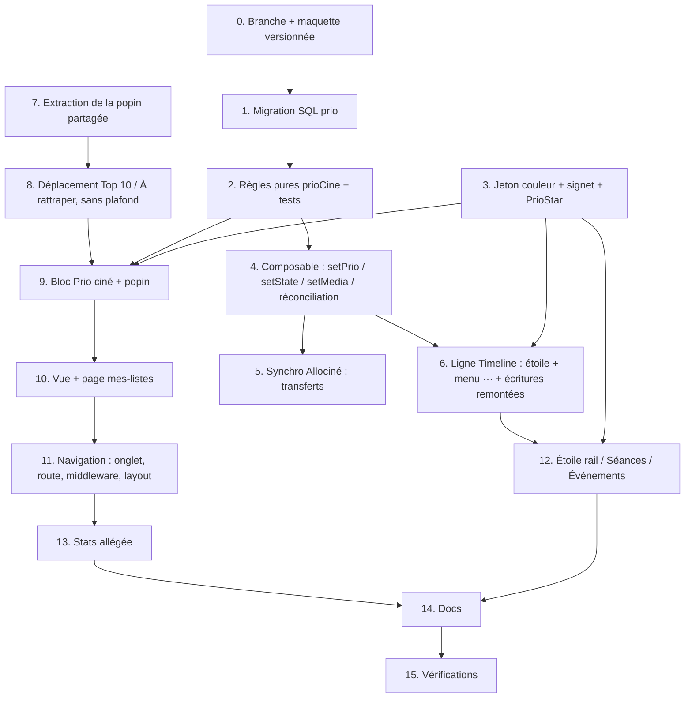

# Onglet « Listes » — Prio ciné, Top 10 Letterboxd et À rattraper

## Summary of intent

Alexis veut repérer d'un coup d'œil les films **actuellement en salle** qu'il veut voir **en priorité**.
Un nouvel onglet « Listes » (groupe « Ma liste », entre Timeline et Stats) regroupe trois listes :
**Prio ciné** (nouvelle, toutes années confondues), **Top 10 Letterboxd** et **À rattraper**, ces deux
dernières déplacées depuis Stats et toujours filtrées par l'année choisie. On ajoute un film aux prios
depuis le slot « Ajouter » (popin : films de ma liste en salle, avec recherche dans ces films) ou depuis
le menu ⋯ de la Timeline (seulement pour un film en salle). Un film en prio porte une étoile jaune à
gauche de son titre (Timeline, rail « Au ciné en ce moment », Séances, Événements). Les deux listes
vivent d'elles-mêmes : une prio
qui n'a plus de séances passe dans À rattraper, et un film d'À rattraper qui retrouve des séances
passe en prio. Terminé quand ces parcours marchent sur les données réelles, que les règles pures sont
couvertes par `npm test` et que Stats n'affiche plus les deux listes déplacées.

## Related context

- **Goal / issue:** demande d'Alexis du 18/11/2026 + maquette `~/Downloads/Timeline.html` (prototype
  React « bundlé », décodé et comparé à `_ressources/tmpl/Timeline.html`). Décisions actées en
  conversation (relayées par l'agent Claire) :
  1. Suggestions et recherche de la popin : **uniquement les films de ma liste à l'état « En salle »**,
     pas de recherche TMDB.
  2. **Aucun plafond**, ni sur Prio ciné (la maquette disait 15) ni sur À rattraper (15 dans le code).
  3. Transfert automatique prio → À rattraper : dans l'année de sortie du film ; déjà dans À rattraper
     → il quitte simplement les prios ; un délai de quelques jours (synchro seulement app ouverte) est
     accepté.
  4. Passer en « vu », supprimer, ou changer de média (≠ cinéma) retire le film des prios. Un film vu
     ne va **pas** dans À rattraper.
  5. Route `/[year]/mes-listes` ; Top 10 et À rattraper retirés de Stats.
  6. Étoile dans la Timeline, Séances et Événements ; **pas** dans la vue d'une liste partagée.
  7. Tri par date de sortie croissante : date manuelle si posée, sinon TMDB ; sans date → en fin.
  8. Menu ⋯ : « Ajouter aux prios » seulement pour un film en salle ; « Retirer des prios » toujours.
  9. **Ajout d'Alexis** : un film d'À rattraper qui retrouve des séances passe dans Prio ciné.
  10. Un film **en salle** ne peut pas être ajouté à À rattraper : le menu ⋯ masque l'entrée « À
      rattraper » pour lui (il propose « Ajouter aux prios »), et la popin À rattraper l'exclut.
  11. Clic sur une carte prio → vue Séances cadrée sur le film.
  12. Étoile aussi dans le rail « Au ciné en ce moment » (`CinemaNowPanel`).
  - Écarts maquette → demande retenus : pas de tag « En salle » sur les cartes prio, pas de tri
    « en salle d'abord », pas de compteur « N/15 », popin avec champ de recherche.
- **Branch:** `feature/onglet-listes-prio-cine`
- **Rules pertinentes:**
  - [`f-a11y-markup.md`](../../.claude/rules/f-a11y-markup.md) — popin (Échap, piège de focus, retour
    du focus), étoile porteuse d'information (`role="img"` + libellé, jamais la couleur seule),
    boutons réels pour les actions.
  - [`f-rscss.md`](../../.claude/rules/f-rscss.md) — classes des nouveaux composants Vue.
  - [`f-scss-variables.md`](../../.claude/rules/f-scss-variables.md) /
    [`f-scss-no-reset-redeclaration.md`](../../.claude/rules/f-scss-no-reset-redeclaration.md) —
    nouveau jeton de couleur, pas de redéclaration.
  - [`f-scss-spacing-rounding.md`](../../.claude/rules/f-scss-spacing-rounding.md) — marges/paddings
    issus de la maquette.
  - ⚠️ Règles du `CLAUDE.md` projet : `.eq('user_id', userIdOf(user.value))` sur toute **lecture** de
    `calendar` ; `isMissingSchema` (`shared/utils/pgErrors.js`) pour une colonne absente ; seules les
    lignes de mon compte s'écrivent.
- **Code existant réutilisé (cf. `f-plan` Step 1.7):**

  | Comportement | Décision | Source |
  |---|---|---|
  | Top 10 Letterboxd (tri, cartes, bande + flèches) | **réutilisé**, déplacé | `app/components/stats/TopRated.vue` |
  | À rattraper (cartes, retrait, popin, repli TMDB) | **réutilisé**, déplacé, plafond retiré | `app/components/stats/Catchup.vue` |
  | Popin de sélection (overlay, Échap, piège de focus, retour du focus, champ, liste d'options) | **extrait** de `Catchup.vue` dans un composant partagé, sans changer son comportement | `Catchup.vue` l. 40-75 + gabarit/styles de la popin |
  | Bande horizontale + flèches | **réutilisé** | `app/composables/useHorizontalStrip.js`, mixins `stripScroll` / `stripArrows` |
  | Bascule d'une colonne booléenne avec patch local sans refetch | **réutilisé** (même forme que `setCatchup`) | `useMovieCalendar.setCatchup` |
  | « A des séances » | **réutilisé** : `state === 'inTheaters'`, tenu par la synchro Allociné | `useInTheatersSync`, `app/utils/inTheaters.js` |
  | Date effective (manuelle > TMDB) | **réutilisé** : `movie.release_date` local vaut déjà la date effective | `effectiveReleaseDate` dans `getMovies` |
  | Libellé de date courte, année d'un film, URL d'affiche | **réutilisé** | `dateShort`, `yearOf`, `posterUrl` (`app/utils/`) |
  | Onglet + compteur dans le rail | **réutilisé** (`count` / `countLabel` déjà gérés) | `app/components/nav/ViewTabs.vue` |
  | Vue ↔ route, année dans l'URL | **réutilisé**, une entrée ajoutée | `useCalendarNav` (`VIEW_BY_ROUTE`, `libraryPath`), `middleware/valid-year.js` |
  | Rafraîchissement des notes Letterboxd à l'ouverture | **réutilisé**, déclencheur déplacé de `stats` à `lists` | `layouts/default.vue` |
  | Écritures d'état / de média depuis la ligne | **remonté** dans le composable (aujourd'hui `MovieListItem` écrit en base sans mettre à jour `movies`) | `MovieListItem.vue` `updateState` / `updateMedia` |
  | Règles pures « qui va dans quelle liste » | **neuf** : rien d'équivalent | → `app/utils/prioCine.js` |
  | Pictogramme étoile | **réutilisé** (`star.svg` = le `ic-star` de la maquette) ; signet **neuf** | `app/assets/svg/star.svg`, → `bookmark.svg` |

- **Skills mobilisées (cf. `f-plan` Step 1.5)** — une skill, un step :
  `f-use-svg` (Step 3) → `f-use-flex`, `f-typography-mixins`, `f-use-mediaquery`, `f-a11y` (Step 9, le
  seul markup neuf d'ampleur) → `f-visual-test` (Step 15, captures + audit axe-core + reflow 320 px).
  Partout ailleurs, la rule `f-a11y-markup` s'applique d'office (champ `Rules:`). `f-implement` pour
  dérouler le plan une fois approuvé ; `f-commit` seulement à la demande d'Alexis.
  Écartées : `f-use-grid` (la grille prio est un `auto-fill` de cartes, pas une mise en page sur les
  colonnes) ; `f-use-wrapper` (les vues de la liste n'ont pas de largeur max) ; `f-figma-to-scss` (pas de
  Figma, maquette HTML) ; `f-manage-component` / `f-use-js-component` (pipeline WordPress, ici des
  composants Vue auto-importés).
  ⚠️ Ces skills décrivent le Starter WordPress : on n'en prend que ce qui existe ici — classes `.flex`
  (`app/assets/styles/components/_flex.scss`), mixins `title-2/4/5`, `body`, `small-body`, `input-body`
  (`_typography-mixins.scss`), variables `$mobile`, `$tablet`… (`_variables.scss`), `<Svg name>`.

## Proposed implementation flow

## Implementation steps

### Step 0 — Branche et maquette

- [x] **Todo:** Créer `feature/onglet-listes-prio-cine` depuis `main`, puis copier la maquette
  `~/Downloads/Timeline.html` sur `_ressources/tmpl/Timeline.html` (même geste que `e14acc0`).
- **Files:** `_ressources/tmpl/Timeline.html` (modify)
- **Réutilise:** convention `chore(tmpl)` existante.
- **Acceptance:** branche active ; `_ressources/tmpl/Timeline.html` identique au fichier téléchargé.

### Step 1 — Migration SQL `prio`

- [x] **Todo:** Écrire la migration qui ajoute `calendar.prio boolean not null default false`, avec en
  tête le pourquoi (tri par date → pas d'horodatage d'ajout, contrairement à `catchup_at`).
- **Files:** `_ressources/sql/2611181315-add-prio-column.sql` (create)
- **Réutilise:** forme de `_ressources/sql/2608041130-add-catchup-at-column.sql`. Les policies de
  `calendar` sont par ligne : rien à ajouter. `useSharedLists` énumère ses colonnes : `prio` ne sort
  pas chez les autres comptes (décision 6), rien à changer.
- **Acceptance:** `add column if not exists` rejouable ; Alexis l'exécute dans le SQL editor Supabase
  (⚠️ action manuelle, à rappeler dans le récap final).

### Step 2 — Règles pures `prioCine` + tests

- [x] **Todo:** Créer `app/utils/prioCine.js` (sans dépendance, importable par le script de tests) :
  - `canAddToPrio(movie)` : `media === 'cinema' && state === 'inTheaters' && !prio`.
  - `prioCandidates(movies, term)` : films `canAddToPrio`, filtrés par titre (insensible à la casse et
    aux accents) quand `term` est non vide, triés comme la liste.
  - `sortPrio(movies)` : `release_date` (date effective) croissante, sans date en fin, puis titre.
  - `prioExitPatch(movie, { now, currentYear })` — invariants côté prio, `null` si rien à faire :
    prio + (`seen` ou média ≠ cinéma) → `{ prio: false }` ;
    prio + état ∉ {`inTheaters`, `seen`} → `{ prio: false, catchup: true, catchup_at: now,
    catchup_year: yearOfMovie(movie) ?? currentYear }`, ou `{ prio: false }` si déjà `catchup`.
    ⚠️ *Écart à l'implémentation :* `yearOfMovie` et non `yearOf(release_date)` — `new Date(null)`
    vaut 1970, le `??` ne se déclenchait jamais et un film sans date partait dans « À rattraper 1970 ».
  - `returnToTheatersPatch(movie)` — ressortie : `catchup` + cinéma + non vu →
    `{ catchup: false, catchup_at: null, prio: true }`, sinon `null`.
  Ajouter la famille 19 `prioCine` à `scripts/test-seances-rules.mjs` (en-tête compris).
- **Files:** `app/utils/prioCine.js` (create), `scripts/test-seances-rules.mjs` (modify)
- **Réutilise:** `releaseDateOf` / `yearOfMovie` (`app/utils/movieDate.js`), structure et assertions du script de tests existant.
- **Acceptance:** `npm test` vert, cas couverts : tri (manuelle > TMDB déjà résolue en amont, sans
  date en fin, égalité → titre), candidats (vu / streaming / déjà prio exclus, recherche avec accents),
  chaque branche des deux patchs (dont « déjà dans À rattraper » et « sans date → année courante »).

### Step 3 — Jeton couleur, signet, composant étoile

- [x] **Todo:** Ajouter `$color-prio: #FFC940` (distinct de `$color-yellow` #F0A935 = « vu en
  streaming »), créer `app/assets/svg/bookmark.svg` depuis le symbole `ic-bookmark` de la maquette
  (`currentColor`), et un petit composant `PrioStar.vue` (`star.svg`, couleur `$color-prio`,
  `role="img"` + `aria-label="Prio ciné"`, taille pilotée par le parent).
- **Files:** `app/assets/styles/_variables.scss` (modify), `app/assets/svg/bookmark.svg` (create),
  `app/components/PrioStar.vue` (create)
- **Réutilise:** `app/assets/svg/star.svg`, `Svg.vue`.
- **Skill:** `f-use-svg` — seule la règle `currentColor` s'applique (projet Nuxt : `app/assets/svg/` +
  `<Svg name>`, pas le helper PHP).
- **Rules:** `f-scss-variables`, `f-a11y-markup`
- **Acceptance:** l'étoile se rend en jaune avec un nom accessible ; le signet hérite de la couleur
  du texte.

### Step 4 — Composable : prio, état, média, réconciliation

- [x] **Todo:** Dans `useMovieCalendar` :
  - `setPrio(id, value)` : même forme que `setCatchup` (écriture, patch local, `sortMovies`).
  - `setState(id, state)` et `setMedia(id, media)` : reprennent les écritures de `MovieListItem`, patchent
    `movies` et appliquent `prioExitPatch` dans **la même** requête `update`.
  - `reconcilePrio()` : applique `prioExitPatch` à tout `movies` (écritures par film, `promisePool`), un
    seul réassign + `sortMovies` ; appelée en fin de `getMovies`. Rattrape aussi un transfert dont
    l'écriture aurait échoué.
  - `applyListPatches(patchesById)` interne, partagée par les trois.
  - Colonne absente (`isMissingSchema`) → avertissement unique, aucune écriture `prio` relancée.
  - `handleMovieDeleted` : rien à faire (la ligne disparaît).
  - *Précisions d'implémentation :* la colonne absente se détecte dès la lecture (`select('*')` ne
    la ramène pas) ; `setPrio(id, true)` refuse un film qui n'a plus de séances et retire d'À rattraper
    un film qui y était (les deux listes s'excluent) ; `reconcilePrio` est attendue dans `getMovies`
    avant `recheckUpcomingCinema`, qui réassigne `movies` depuis une copie et effacerait ses patchs.
- **Files:** `app/composables/useMovieCalendar.js` (modify)
- **Réutilise:** `setCatchup`, `promisePool`, `patchCalendarRow` si son repli « colonne absente »
  convient, `isMissingSchema`.
- **Acceptance:** passer une prio en « vu » ou en streaming la retire de la liste sans rechargement ;
  après rechargement, l'état en base est cohérent ; aucune requête `prio` quand la colonne manque.

### Step 5 — Synchro Allociné : transferts automatiques

- [x] **Todo:** Dans `useInTheatersSync` :
  - après l'écriture des groupes `keep` / `drop` de `syncInTheaters`, appliquer `returnToTheatersPatch`
    aux films du groupe `keep` (ressortie → prio), puis `reconcilePrio()` (prio du groupe `drop` →
    À rattraper) ;
  - en fin de `pruneEmptyHorizon`, `reconcilePrio()`.
  ⚠️ **Pas** dans `applyAutoInTheaters` : sa promotion est optimiste, sans preuve de séances ; elle
  ferait sauter en prio un film tout juste ajouté à À rattraper.
  *Implémenté :* `promoteReturnedToPrio(ids)` et `reconcilePrio()` exposées par `useMovieCalendar`
  (la synchro ne fournit que ses preuves) ; vérifié sur base simulée (banc jetable du scratchpad,
  32 cas : transferts, verdict `null`, horizon vide, colonne absente).
- **Files:** `app/composables/useInTheatersSync.js` (modify)
- **Réutilise:** les verdicts déjà calculés (`keep`, `drop`, `gone`), aucune requête Allociné en plus.
- **Acceptance:** sur des données simulées (une prio dont le verdict tombe à `false`, un film
  d'À rattraper dont le verdict est `true`), les deux films changent de liste après la synchro, et
  rien ne bouge sur un verdict `null`.

### Step 6 — Ligne de la Timeline : étoile, menu ⋯, écritures remontées

- [x] **Todo:**
  - `MovieListItem` : `PrioStar` à gauche du titre, **hors** du lien Letterboxd, si `prio && !shared` ;
    les sélecteurs d'état et de média émettent `state-changed` / `media-changed` au lieu d'écrire en base.
  - `MovieActionsBtn` : nouvelles props `state`, `media`, `prio` ; entrée « Retirer des prios » si
    `prio`, « Ajouter aux prios » si `canAddToPrio` (icône étoile, `$color-prio`) ; émet `toggle-prio`.
    L'entrée « À rattraper » est masquée pour un film en salle, sauf pour le retirer s'il y est déjà
    (décision 10).
  - `MovieActionsBtn` (a11y) : après une action, le focus revient sur le bouton ⋯ — aujourd'hui le
    menu se démonte et le focus tombe sur `<body>`, pour toutes les entrées.
  - Annonce « « Titre » ajouté aux prios ciné » / « retiré des prios ciné » dans la zone live du layout.
  - `TimelineList` et `pages/[year]/timeline.vue` : relais `toggle-prio` → `setPrio`,
    `state-changed` → `setState`, `media-changed` → `setMedia`.
  - *Implémenté en plus :* la phrase d'annonce vit dans `prioAnnouncement` (`prioCine.js`, testée),
    partagée avec l'onglet Listes ; ouvrir « Modifier la date » pose le focus dans le champ date (même
    perte de focus que les autres entrées). Non traité : après « Supprimer », la ligne entière disparaît
    et le focus avec elle — défaut antérieur, hors périmètre, signalé au récap.
- **Files:** `app/components/MovieListItem.vue`, `app/components/MovieActionsBtn.vue`,
  `app/components/TimelineList.vue`, `app/pages/[year]/timeline.vue` (modify)
- **Réutilise:** l'entrée « À rattraper » du menu comme modèle ; `canAddToPrio` (Step 2) ;
  `announceMovie` de `useMovieHighlight` (zone `
` déjà dans
  `layouts/default.vue`).
- **Rules:** `f-a11y-markup`
- **Acceptance:** le menu d'un film en salle propose « Ajouter aux prios » et l'étoile apparaît
  aussitôt ; un film hors salle ne le propose pas ; la vue d'une liste partagée n'affiche aucune étoile.

### Step 7 — Extraire la popin de sélection

- [x] **Todo:** Sortir de `Catchup.vue` la popin (overlay, Échap, piège de focus, retour du focus,
  champ de recherche, liste d'options avec affiche/titre/date, état vide) dans `lists/FilmPicker.vue` :
  props `title`, `count` (optionnel), `hint` (optionnel), `options`, `emptyText`, `searchLabel` ;
  `v-model:query` ; événements `select`, `close`. `Catchup.vue` l'utilise et garde sa logique
  (suggestions de l'année, repli TMDB). **Aucun changement de comportement.**
  *Implémenté :* prop `label` en plus (nom accessible du dialogue ≠ titre visible) ; la popin capture
  le déclencheur à son montage et lui rend le focus à son démontage ; textes en `
`, options en
  `<ul role="list">` ; animation renommée `picker-pop`.
- **Files:** `app/components/lists/FilmPicker.vue` (create), `app/components/stats/Catchup.vue` (modify)
- **Réutilise:** `Catchup.vue` l. 40-75 (focus) + gabarit et styles de la popin, animation `catchup-pop`.
- **Rules:** `f-a11y-markup`, `f-rscss`
- **Acceptance:** la popin À rattraper fonctionne exactement comme avant (suggestions, repli TMDB,
  Échap, Tab bouclé, focus rendu au slot).

### Step 8 — Déplacer Top 10 et À rattraper, retirer le plafond

- [x] **Todo:** `git mv` de `stats/TopRated.vue` et `stats/Catchup.vue` vers `lists/` (les composants
  deviennent `ListsTopRated` / `ListsCatchup`). Dans `Catchup` : supprimer `MAX_CATCHUP`, un **seul**
  slot « Ajouter » en fin de bande, compteur « N » sans dénominateur ; exclure les films en salle des
  suggestions (décision 10). Mise en conformité minimale pour leur nouvelle page : titre de bloc en
  `<h2>` (la vue porte le `h1`), bande en `<ul role="list">` / `<li class="cell">`.
  *Implémenté en plus :* l'année dans les deux titres, comme la maquette (« Top 10 Letterboxd 2026 —
  pas encore vus », « À rattraper en 2026 ») ; compteur doublé d'un « films » pour lecteur d'écran ;
  le repli TMDB écarte aussi mes films en salle (sinon `addCatchupMovie` les marquait par la ligne
  existante) ; classes racines renommées `lists-toprated` / `lists-catchup` ; `StatsView` pointe
  provisoirement les nouveaux noms jusqu'au Step 13.
- **Files:** `app/components/lists/TopRated.vue`, `app/components/lists/Catchup.vue` (move + modify)
- **Réutilise:** les deux composants tels quels ; `useHorizontalStrip` cible `.cell`, conservé sur les `li`.
- **Rules:** `f-a11y-markup`
- **Acceptance:** plus de limite d'ajout ; une liste vide montre un seul slot « Ajouter » ; flèches de
  défilement intactes.

### Step 9 — Bloc « Prio ciné »

- [x] **Todo:** Créer `lists/Prio.vue` d'après la maquette : encadré à dégradé jaune, en-tête étoile +
  « Prio ciné » + compteur, accroche « Les films à voir en salle en premier. Ajoute-les ici ou via ⋯
  dans la Timeline. », grille `auto-fill` de cartes 96 px (affiche, bouton « Retirer « Titre » des
  prios », titre sur 2 lignes, date courte + année si ≠ année courante, « Sans date » sinon), slot
  « Ajouter » en dernier. **Pas** de tag « En salle ». Liste = `sortPrio(movies.filter(prio))`.
  Popin `FilmPicker` : titre « Prio ciné », accroche « Films de ta liste en salle en ce moment. »,
  options = `prioCandidates(movies, query)`, vide → « Aucun autre film en salle dans ta liste. ».
  Clic sur une carte → la vue Séances cadrée sur le film (`goToSeances`, décision 11).
  Markup : titre en `<h2>`, cartes en `<ul role="list">`. Au retrait d'une carte, le focus passe au
  bouton de la carte suivante (ou au slot « Ajouter ») et le retrait est annoncé ; même retour de
  focus appliqué au retrait d'une carte À rattraper. Une seule media query (`#{$mobile}` : grille
  justifiée `space-between`), en fin de bloc.
  *Implémenté :*
  - retour d'Alexis (18/11) : accroche du bloc retirée, titre « Prio ciné » au style des titres
    Top 10 / À rattraper (petites capitales grises) ;
  - retours d'Alexis (suite) : fond et bordure alignés sur les autres listes ; en mobile, la grille
    devient une bande à flèches comme Top 10 / À rattraper ; sous-titre « … suivent l'année »
    retiré de `ListsView` ;
  - carte = **lien** (`NuxtLink`) et non bouton : c'est une navigation. La route sort de `goToSeances`
    (`seancesRoute`, `useCalendarNav`), la page n'a plus rien à câbler pour le clic ;
  - date « 04 NOV » (+ année si ≠ année courante) : format **extrait** de `CinemaNowPanel`
    (`dayMonthShort`, `movieDate.js`) au lieu d'une troisième copie, et `prioDateLabel` (`prioCine.js`),
    tous deux testés ; le `dateShort` de l'app (« nov. 2026 ») ne correspondait pas à la maquette ;
  - `f-a11y` : popin nommée par un `h2`, page `inert` derrière elle (`app/utils/inertOutside.js`, levé
    avant le retour du focus), déclencheur transmis à la popin (Safari ne focalise pas un bouton
    cliqué), slots `aria-haspopup="dialog"` + nom complété (« Ajouter un film aux prios ciné »),
    croix nommées d'après le film, affiches en `alt=""` (carte nommée par son titre), anneaux de focus
    sur toutes les cartes, croix, slots et flèches des trois blocs (aucun n'en avait : le reset coupe
    les contours) — intérieurs dans les bandes, qui coupent ce qui dépasse en hauteur ;
  - `f-typography-mixins` : aucun mixin ne descend à ces tailles (11 à 17 px) → `font` aligné sur les
    cartes voisines, à signaler au récap.
- **Files:** `app/components/lists/Prio.vue` (create), `app/components/lists/Catchup.vue` (modify,
  retour de focus)
- **Réutilise:** `FilmPicker` (Step 7), styles de carte / slot de `Catchup.vue`, `sortPrio`,
  `prioCandidates`, `dateShort`, `posterUrl`, `PrioStar`, `announceMovie`.
- **Skill:** `f-use-flex`, `f-typography-mixins`, `f-use-mediaquery`, `f-a11y`
- **Rules:** `f-a11y-markup`, `f-rscss`, `f-scss-spacing-rounding`, `f-scss-typography-mixins`
- **Acceptance:** ajout depuis la popin, retrait depuis la carte, tri par date, rendu conforme à la
  maquette à 1440 px et 375 px.

### Step 10 — Vue et page « Mes listes »

- [x] **Todo:** `ListsView.vue` : titre « Mes listes » (`h1`), sous-titre « Top 10 et À rattraper
  suivent l'année X », puis `ListsPrio`, `ListsTopRated`, `ListsCatchup` empilés (Top 10 et
  À rattraper en `<ClientOnly>` comme dans Stats). Page `pages/[year]/mes-listes.vue` :
  `definePageMeta({ key: 'lists', middleware: ['auth', 'valid-year'] })`, titre « Mes listes »,
  câblage `setPrio`, `setCatchup`, `onAddCatchupMovie`, `goToMovie`, `goToSeances`.
  *Implémenté :* plus de `goToSeances` à câbler (la carte prio est un lien) ; ajout + annonce dans
  `usePrioToggle` (nouveau composable, partagé avec la Timeline au lieu de deux copies) ; sous-titre
  en `$color-text-quiet` et non le gris de la maquette (`$color-text-weaker`, 3,7:1 < 4,5:1).
- **Files:** `app/components/ListsView.vue` (create), `app/pages/[year]/mes-listes.vue` (create)
- **Réutilise:** gabarit, styles d'en-tête et media queries de `StatsView.vue` (point de bascule du
  shell à 999 px, sans variable équivalente — on reste aligné sur Stats), câblage de
  `pages/[year]/stats.vue`, `useCatchupFlow`.
- **Rules:** `f-a11y-markup` (un seul `h1`)
- **Acceptance:** `/2026/mes-listes` affiche les trois blocs ; changer d'année ne change que Top 10 et
  À rattraper.

### Step 11 — Navigation

- [x] **Todo:**
  - `ViewTabs` : onglet `{ key: 'lists', mode: 'lists', icon: 'bookmark', label: 'Listes', count:
    nombre de prios, countLabel: 'films en prio ciné' }` entre Timeline et Stats (compteur au rail
    seulement, comme Événements).
  - `useCalendarNav` : `'year-mes-listes': 'lists'` dans `VIEW_BY_ROUTE` ; `libraryPath` traduit `lists`
    en segment `mes-listes`.
  - `middleware/valid-year.js` : une année invalide sur `mes-listes` y reste.
  - `layouts/default.vue` : le rafraîchissement des notes Letterboxd suit `lists` au lieu de `stats`
    (watch + montage).
  - *Implémenté :* `libraryPath` passe par une table `LIBRARY_SEGMENTS` (`shared` → `timeline`,
    `lists` → `mes-listes`) ; le middleware lit une table explicite au lieu de `endsWith('stats')` ;
    compteur de l'onglet retiré à la demande d'Alexis (18/11) ; la
    synchro Letterboxd quitte Stats sans perte — le Top 10 était son seul lecteur.
- **Files:** `app/components/nav/ViewTabs.vue`, `app/composables/useCalendarNav.js`,
  `app/middleware/valid-year.js`, `app/layouts/default.vue` (modify)
- **Réutilise:** mécanique `count` / `countLabel` de l'onglet Événements, `libraryPath`.
- **Rules:** `f-a11y-markup`
- **Acceptance:** onglet présent (rail et bande mobile), actif sur la bonne route, changement d'année
  depuis Listes reste sur Listes, `/abcd/mes-listes` → `/2026/mes-listes`, notes Letterboxd
  rafraîchies à l'ouverture de Listes.

### Step 12 — Étoile dans le rail, Séances et Événements

- [x] **Todo:** `PrioStar` devant le titre du film dans `seances/SeanceGroup.vue` (en-tête en mode
  film, ligne en mode cinéma), `events/Card.vue` (ligne de film) et `CinemaNowPanel.vue` (rail « Au
  ciné en ce moment », décision 12), si `movie.prio`.
  *Implémenté :* aussi dans l'en-tête des cartes Événements regroupées par film ; dans le rail et
  les lignes d'Événements, le film est un bouton à `aria-label`, qui **remplace** son contenu —
  l'étoile y serait muette, d'où « , en prio ciné » ajouté à `itemLabel` / `rowLabel`.
- **Files:** `app/components/seances/SeanceGroup.vue`, `app/components/events/Card.vue`,
  `app/components/CinemaNowPanel.vue` (modify)
- **Réutilise:** `PrioStar` ; les films de ces vues sont les objets de `movies` (`seanceFilms`,
  `useEvents`), `prio` y est déjà.
- **Rules:** `f-a11y-markup`
- **Acceptance:** une prio est étoilée dans le rail (desktop et bande mobile), Séances et Événements,
  sans se confondre avec l'étoile « salle favorite » (contour rose) ni le pictogramme d'événement
  (cf. risques).

### Step 13 — Stats allégée

- [x] **Todo:** Retirer de `StatsView` le bloc `<ClientOnly>` Top 10 / À rattraper et le relais
  d'événements ; nettoyer `pages/[year]/stats.vue` (plus de `setCatchup` ni `useCatchupFlow`).
- **Files:** `app/components/StatsView.vue`, `app/pages/[year]/stats.vue` (modify)
- **Réutilise:** —
- **Acceptance:** Stats affiche le reste sans trou dans la grille ; aucun import mort.

### Step 14 — Documentation

- [x] **Todo:** Rédiger `_ressources/README-listes-prio-cine.md` (règles, transferts, pourquoi pas dans
  `applyAutoInTheaters`, migration à jouer) ; pointer `README-stats-top10-catchup.md` vers le nouvel
  emplacement ; mettre à jour `CLAUDE.md` (colonne `prio`, page `/[year]/mes-listes`, couverture de
  `npm test`).
- **Files:** `_ressources/README-listes-prio-cine.md` (create), `_ressources/README-stats-top10-catchup.md`,
  `CLAUDE.md` (modify)
- **Acceptance:** un lecteur retrouve la règle de chaque transfert et l'action manuelle (migration).

### Step 15 — Vérifications

- [x] **Todo:** `npm test` ; `npm run dev` puis `f-visual-test` sur `/2026/mes-listes`, la Timeline,
  `/seances` et la popin, à 1440 et 375 px (+ audit axe-core et reflow 320 px), comparés à la maquette ;
  `grep` des anciens noms `StatsTopRated` / `StatsCatchup`. Navigateur **headless** uniquement
  (Playwright `channel: 'chrome'`, scripts dans le scratchpad — règle globale d'Alexis).
  ⚠️ Pas de `npm run build` pendant que le dev tourne.
- **Skill:** `f-visual-test`
- **Acceptance:** tests verts, captures conformes ; ce qui demande une session authentifiée (écritures
  réelles, transferts sur données vraies) est listé pour le test manuel d'Alexis.
  *Réalisé (sans compte de test) :*
  - `npm test` 570/570 ; aucun ancien nom (`StatsTopRated`, `StatsCatchup`, `MAX_CATCHUP`) ; tous les SFC
    touchés compilent (script + gabarit + SCSS avec les `additionalData` du projet) ;
  - composables vérifiés sur base simulée (banc jetable, 32 cas : transferts, verdict `null`, horizon
    vide, colonne absente) ;
  - `f-visual-test` sur une page d'aperçu **temporaire** (vrais composants, fausses données, supprimée
    ensuite) : 4 vues × 1440 / 375 / 320 px, reflow 320 ✅ partout, 38 parcours clavier verts (popin,
    inertie, Échap, tri, retours de focus, menu ⋯, étoile, rail, Séances), 0 erreur console ;
  - corrigé en cours de route : croix de retrait à 24 px (WCAG 2.5.8, la maquette disait 22),
    animations de la popin et du menu ⋯ conditionnées à `prefers-reduced-motion: no-preference` ;
  - le script du skill lance `chromium.launch()` sans `channel: 'chrome'` : copie corrigée dans le
    scratchpad, le skill partagé n'est pas modifié ;
  - `/2026/mes-listes` existe (302 → `/login` sans session, comme les autres pages gardées).
  *Constats existants, non traités (lot créa) :* titres Top 10 / À rattraper et « Ajouter »
  d'À rattraper en `$color-text-weak` (2,7:1), dates du rail, compteurs de mois ; libellés du rail sans
  la date visible (label-in-name) ; liens Letterboxd `_blank` sans mention ; `id` dupliqués de
  `SelectBtn` ; flèches de bande `disabled` en bout de course (le focus tombe sur `<body>`).

## Dependencies and ordering

- Step 1 (migration jouée) avant tout test réel d'écriture ; le code tolère une colonne absente.
- Step 2 avant 4, 5, 6, 9 (ils consomment les règles pures).
- Step 7 avant 8 et 9 (popin partagée) ; Step 8 avant 10 et 13.
- Step 3 avant 6, 9 et 12 (`PrioStar`, jeton, signet).
- Step 11 après 10 (la route doit exister).
- Ordre des skills : `f-use-svg` (3) → `f-use-flex` → `f-typography-mixins` → `f-use-mediaquery` →
  `f-a11y` (tous au 9) → `f-visual-test` (15).

## Risks and unknowns

| Risk / unknown | Mitigation |
|----------------|------------|
| Remonter les écritures d'état/média dans le composable (Step 4/6) rend leurs effets **immédiats** : avec un filtre « Envie de voir » actif, une ligne passée en « vu » disparaît tout de suite (aujourd'hui elle reste jusqu'au rechargement), et le rail se met à jour sans rechargement. | Assumé : c'est l'état réel. Signalé à Alexis au récap. |
| Données existantes : des films déjà « À rattraper » et encore en salle passeront en prio à la prochaine synchro hebdomadaire. | Conforme à la règle 9 ; signalé au récap. |
| Transfert vers l'année de sortie : une prio de 2025 transférée atterrit dans « À rattraper 2025 » et disparaît de la vue 2026. | Décision 3 actée ; documenté. |
| Délai : la synchro tourne au plus une fois par semaine ciné, et seulement app ouverte. | Accepté (décision 3) ; `pruneEmptyHorizon` accélère le cas d'un film parti en cours de semaine quand la vue Séances est ouverte. |
| Deux écritures (état puis listes) dans la synchro : si la seconde échoue, une prio reste avec un état ≠ en salle. | `reconcilePrio()` au chargement suivant rattrape le côté prio ; la ressortie se rejoue à la synchro suivante. |
| Code déployé avant la migration. | `isMissingSchema` → avertissement unique, aucune écriture `prio`, l'onglet affiche une liste vide. |
| Étoile jaune à côté de l'étoile « favori » (contour) et du pictogramme événement dans Séances. | Couleur et forme distinctes (pleine, `$color-prio`) + nom accessible « Prio ciné » ; à valider sur capture. |
| Toutes ces pages sont derrière le middleware `auth` : `f-visual-test` ne capture que la page de connexion sans session. | Demander à Alexis un compte de test (identifiants en variables d'environnement locales, jamais dans le dépôt) ; à défaut, liste de vérifications manuelles. |
| `f-typography-mixins` interdit le `font:` écrit à la main, alors que les cartes existantes (`Catchup`, `TopRated`) l'écrivent partout. | Mixin ou classe dès qu'un style de la maquette y correspond ; sinon cohérence avec les cartes voisines, signalée au récap plutôt qu'un refactor hors périmètre. |

## Handoff to implementation

- **Plan file:** `_ressources/plans/2611181315-onglet-listes-prio-cine.md`
- **First todo:** Step 0 — Branche et maquette
- **Out of scope:** plafonds de listes ; recherche TMDB dans la popin prio ; étoile dans les listes
  partagées ; job serveur pour la synchro « en salle » ; refonte du reste de Stats ; commit et PR
  (sur demande d'Alexis seulement).

**Next action:** Work implementation steps in order, checking off each `- [ ]` as completed.
